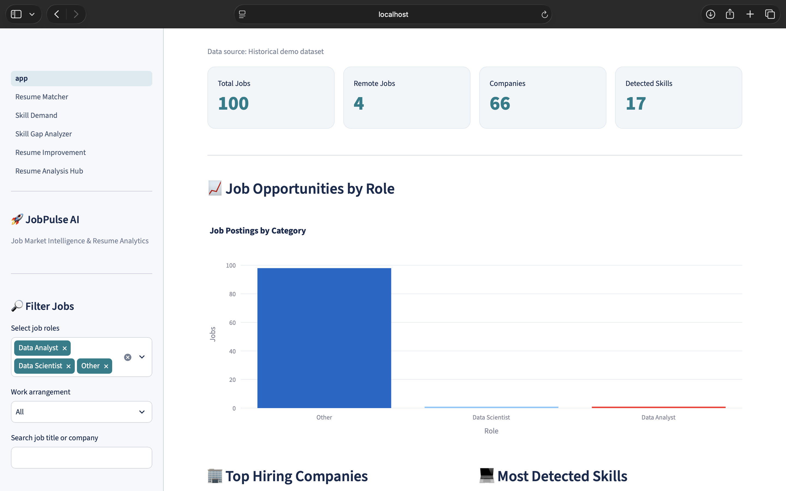
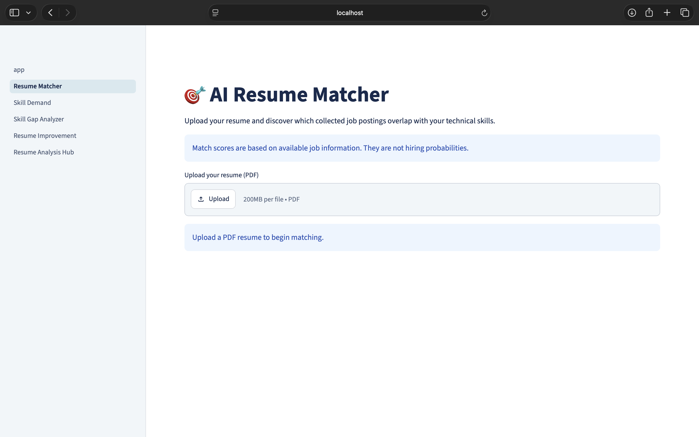
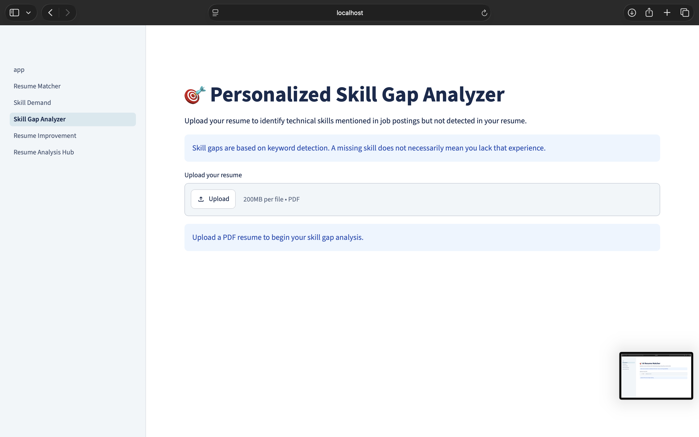

# 🚀 JobPulse AI

### AI-Powered Job Market Intelligence & Resume Analytics

JobPulse AI is a Python and Streamlit application that
helps job seekers explore job-market data, evaluate
resume skill coverage, and identify potential skill gaps.

## 🌐 Live Demo

[Launch JobPulse AI](https://jobpulse-ai-jp.streamlit.app)

## ✨ Features

- Interactive job-market dashboard
- Job filtering and data visualizations
- PDF resume parsing and skill extraction
- Keyword-based resume-to-job matching
- Semantic matching using sentence-transformers
- Skill demand and gap analysis
- Rule-based resume bullet rewriting
- Job-specific skill overlap reports
- Downloadable CSV and text reports

## 📸 Application Screenshots

### Job Market Dashboard

### Resume Matcher

### Skill Gap Analyzer

## 🛠️ Tech Stack

| Category | Technologies |
|----------|--------------|
| Language | Python |
| Web Application | Streamlit |
| Data Processing | Pandas |
| Visualizations | Plotly |
| NLP | Sentence Transformers |
| PDF Processing | PyMuPDF |
| Database | SQLite |
| Deployment | Streamlit Community Cloud |
| Version Control | Git & GitHub |

## 🏗️ Architecture

PDF Resume
    |
    v
Resume Text Extraction
    |
    v
Skill Detection
    |
    v
Job Dataset
    |
    v
Keyword / Semantic Matching
    |
    v
Skill Gap Analysis
    |
    v
Interactive Reports

## 📊 Data

The deployed demo uses a limited historical job dataset.

The application is not a live job-search service.
Skill overlap scores are not hiring probabilities.

## 💻 Run Locally

1. Clone the repository:

   git clone YOUR_GITHUB_REPOSITORY_URL

2. Navigate to the project folder.

3. Create and activate a virtual environment:

   python3 -m venv .venv
   source .venv/bin/activate

4. Install dependencies:

   pip install -r requirements.txt

5. Start the application:

   streamlit run app.py

## 🔮 Future Enhancements

- Live job API integration
- More advanced job description matching
- Personalized learning recommendations
- Expanded salary and hiring trend analytics

## 📌 Project Status

Version 1.0 — Portfolio Demo
